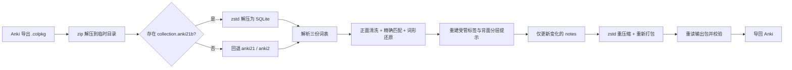

# Anki-Vocab-Tagger

**中小学 / 中高考 Anki 单词精细化分级与“四会”标红工具**

> 把“哪些词必须会拼写、哪些词是母语高频”直接写进卡片背面，而不是让你盲目背下词表里的每一个词。

`process_deck.py` 读取 Anki 导出的 `.colpkg`，结合国内应试词表与 Longman 高频语料库，为每张卡片自动打标签、注入分层视觉提示，然后重新打包成可直接导回 Anki 的牌组包。全程离线处理，不改动原有学习进度。

---

## 目录

- [为什么需要它](#为什么需要它)
- [方案：双保险机制](#方案双保险机制)
- [特性亮点](#特性亮点)
- [快速开始](#快速开始)
- [输出效果](#输出效果)
- [可调配置](#可调配置)
- [项目结构](#项目结构)
- [处理流程](#处理流程)
- [已知限制](#已知限制)
- [深度技术文档](#深度技术文档)
- [声明](#声明)

---

## 为什么需要它

背单词最大的浪费，是把“认识即可”的词当成“必须会拼”的词来练。

- **拼写负担过重**：中高考 3500 词里，大量词汇只要求阅读认知；要求听、说、读、写“四会”的，主要是中考 1600 词。对所有词一视同仁，等于把时间平均撒在低回报项上。
- **单一词表必有盲区**：课标词表会漏掉日常高频词。例如 `bag` 不在 1600 词解析结果中，却出现在 3500 词和 Longman 高频词里；只看考纲，就会错过这个词的母语核心地位。
- **通用工具不懂国内考纲**：大多数 Anki 插件并不区分“中考四会”“高考认知”“母语高频”这三种完全不同的掌握要求。

本项目要解决的就是这三件事：**分层、兜底、可重复。**

---

## 方案：双保险机制

采用“**应试考纲（1600 / 3500） + 权威语料库（Longman 3000）**”双保险机制：

| 层级 | 数据源 | 标签 | 卡片背面提示 | 定位 |
|---|---|---|---|---|
| 应试核心 | `1600.txt` | `zk16k` | **顶部红字**：中小学1600词（必须掌握听说读写） | 中考高频，最高优先级，要求四会 |
| 母语高频兜底 | `LONGMAN3000.txt` | `lm3k_core` | **顶部灰色小字**：`Longman Core (S1)` 等 | 补足考纲漏录的日常高频词 |
| 高中认知 | `3500.txt` | `gk35k` | 无视觉提示 | 高考认知词汇，只打标签，避免提示墙 |

Longman 频级含义：

- `S1` ~ `S3`：口语（Spoken）高频级别，`S1` 最高；
- `W1` ~ `W3`：书面语（Written）高频级别，`W1` 最高。

默认只把 `S1`、`W1` 视为母语核心，可通过配置自由扩展。

**红字与灰字可以同时出现，且顺序固定：灰字在上，红字紧随其后，最后才是原卡片正文。** 红字代表“必须会”，灰字代表“母语里很常用”，两者语义不同，不会互相覆盖。

---

## 特性亮点

### 视觉分层，而不是信息堆砌

- 命中 1600 词：背面顶部出现红色加粗提示，明确“必须掌握听说读写”；
- 命中 Longman 目标频级：顶部出现灰色小字，并显示实际命中的级别（如 `S1`、`W1`、`S1, W1`）；
- 只命中 3500 词：仅添加 `gk35k` 标签，不抢占卡片视觉。

### 智能词元还原（Lemmatization）

精确字符串匹配会漏掉大量变形词。脚本内置一个**自包含、保守**的英文词形还原器，不依赖 NLTK / spaCy 模型：

- be 动词变体：`am / is / are / was / were / been / being`；
- 不规则动词：`ate → eat`、`bought → buy`、`went → go`、`wrote → write`、`swam → swim`；
- 不规则复数：`children → child`、`men → man`、`feet → foot`；
- 规则复数、过去式、现在分词：`shoes → shoe`、`socks → sock`、`noodles → noodle`；
- 常见缩写：`that's → that`、`they're → they`、`won't → will`。

匹配优先级经过专门设计：原形本身命中时优先使用原形，避免把方向词 `left` 强行还原成 `leave`；只有原形不命中时才尝试词元。多词短语与连字符词不做逐词还原，防止误标。

### 完美适配现代 Anki

- 原生处理现代 `.colpkg` 的真实数据库 `collection.anki21b`（**zstd 压缩的 SQLite**），而不是误读只有占位提示的 `collection.anki2`；
- 保留原始 `meta`、`media` 与旧格式兼容文件，仅替换数据库；
- **不触碰 `cards` 表与调度字段**，包内学习进度、复习历史完整保留；
- 同时兼容旧格式 `collection.anki21` / `collection.anki2`，自动回退；
- 内置 `unicase` 排序规则近似实现，保证 Anki schema 上的完整性与查询可执行。

### 幂等：可以放心重复运行

- 每次先剥离所有已知的旧提示块，再按固定顺序重建，不会叠加、不会残留；
- 受管标签（`lm3k_core`、`zk16k`、`gk35k`，以及旧版 `lm3kw1`）全部重建，用户自定义标签原样保留；
- 只有内容或标签真正变化的笔记才更新 `mod` / `usn`；
- 对已处理过的包再次运行（以上一次输出作为输入），`updated = 0`；原始牌组增量更新后重新处理，也只更新真正变化的笔记。

### 灵活可调

- Longman 目标频级可自由组合：`{"W1", "S1"}`、`{"W1"}`、`{"W1", "S1", "W2"}`……
- 输入、输出、三份词表路径均可通过命令行指定；
- 输出文件与输入文件相同时直接报错，杜绝原地覆盖。

### 自带交付校验

打包完成后会重新打开输出包，执行：

- SQLite `PRAGMA integrity_check`；
- 标签计数与提示计数比对；
- 旧标签、旧提示残留检查；
- 重复提示检查。

任一项不符即失败，不会静默产出坏包。

---

## 快速开始

### 环境要求

- Python **3.9+**
- 现代 Anki（使用 `collection.anki21b` 的版本；旧格式自动兼容）
- Python 依赖：`zstandard`

```bash
git clone https://github.com/<your-name>/anki-vocab-tagger.git
cd anki-vocab-tagger

python3 -m venv .venv
source .venv/bin/activate        # Windows: .venv\Scripts\activate
python3 -m pip install --upgrade pip
python3 -m pip install zstandard
```

> 词表文件 `1600.txt`、`3500.txt`、`LONGMAN3000.txt` 已随仓库提供。若从其他来源替换，请保持“一行一个词条”的解析约定，或参考深度文档调整解析器。

### 第一步：从 Anki 导出牌组

1. 打开 Anki，切到要处理的配置文件；
2. **文件 → 导出**；
3. 选择 **Anki 牌组包（`.colpkg`）**，勾选包含媒体（如牌组有图片/音频）；
4. 导出到本地，例如 `~/Downloads/my_deck.colpkg`。

> 导出前请确认这是你当前最新的学习进度。`.colpkg` 是整库包，导回 Anki 时会以包内数据为准。

### 第二步：运行脚本

```bash
python3 process_deck.py \
  --deck ~/Downloads/my_deck.colpkg \
  --out ./my_deck_tagged.colpkg
```

三份词表默认读取脚本所在目录，无需额外传参。也可以全部显式指定：

```bash
python3 process_deck.py \
  --deck   ~/Downloads/my_deck.colpkg \
  --longman ./LONGMAN3000.txt \
  --zk16k   ./1600.txt \
  --gk35k   ./3500.txt \
  --out     ./my_deck_tagged.colpkg
```

脚本不会修改输入文件。输出路径与输入路径相同时会直接报错。

运行结束会打印命中统计与校验结果：

```text
===== 处理完成 =====
Longman Core 目标频级: S1, W1
Longman Core 词条数: ...
词形还原命中的单词数: ...
命中 zk16k 并添加红字提示的卡片数: ...
命中 lm3k_core 并添加灰字提示的卡片数: ...
两者同时命中的卡片数: ...
...
输出包校验通过（SQLite integrity_check / 标签 / 提示计数一致）。
```

### 第三步：导回 Anki

1. 建议先备份当前 Anki 配置（或使用一个临时配置文件试导入）；
2. **文件 → 导入**，选择 `my_deck_tagged.colpkg`；
3. 按 Anki 提示确认。导入后打开任意卡片，检查背面顶部的灰字/红字是否符合预期；
4. 在浏览器中按 `tag:zk16k`、`tag:lm3k_core`、`tag:gk35k` 筛选，即可分别复习三类词汇。

> `.colpkg` 导入会以包内集合为准。请在导出后尽快完成“打标签 → 导回”，不要在中间继续学习，否则这部分新进度不会被包含。

---

## 输出效果

以真实牌组中的词为例：

| 单词 | 词表命中 | 最终标签 | 背面顶部提示 |
|---|---|---|---|
| `bag` | Longman `S1, W2`；3500 | `lm3k_core gk35k` | 灰字 `Longman Core (S1)`，无红字 |
| `apple` | 1600；3500 | `zk16k gk35k` | 红字，无灰字 |
| `children` | 还原为 `child`：Longman `S1, W1`、1600、3500 | `lm3k_core zk16k gk35k` | 灰字 `S1, W1` + 红字 |
| `socks` | 还原为 `sock`：1600、3500 | `zk16k gk35k` | 红字 |
| `ache` | 仅 3500 | `gk35k` | 无提示 |

`bag` 是双保险机制的关键示例：它不在 1600 词中，拿不到“必须四会”的红字；但它在 Longman 中属于 `S1`，因此仍会被灰字标记为母语核心词，不会被漏掉。

---

## 可调配置

打开 `process_deck.py`，修改顶部配置：

```python
# 任意组合，例如 {"W1", "S1"} 或 {"W1", "S1", "W2"}
LONGMAN_CORE_TARGETS = {"W1", "S1"}
```

常见组合：

| 目标集合 | 效果 |
|---|---|
| `{"W1", "S1"}` | 默认。只标记母语中最核心的口语/书面高频词 |
| `{"W1"}` | 更严格，仅书面最高频 |
| `{"W1", "S1", "W2"}` | 更宽松，纳入次高频书面词 |
| `{"S1", "S2", "S3", "W1", "W2", "W3"}` | 标记 Longman 全部频级 |

修改后重新对**原始牌组**运行即可。脚本会先清除旧的灰字/红字，不会因配置切换而残留旧提示。

---

## 项目结构

```text
anki-vocab-tagger/
├── process_deck.py          # 主脚本：解析词表、处理 colpkg、注入提示、重打包与校验
├── 1600.txt                 # 中考 1600 词表（红字“四会”来源）
├── 3500.txt                 # 高考 3500 词表（仅打 gk35k 标签）
├── LONGMAN3000.txt          # Longman 3000 高频词表（S1~S3 / W1~W3，灰字来源）
├── README.md                # 项目首页（本文件）
├── README_MAINTENANCE.md    # 深度技术文档：底层格式、OCR、词形还原、维护 SOP
└── .gitignore               # 忽略牌组包、缓存、临时目录与 IDE 杂项
```

运行后还会生成：

| 文件 | 说明 |
|---|---|
| `*_tagged.colpkg` | 处理后的可导入牌组包 |
| `__pycache__/` | Python 缓存（已忽略） |

`.colpkg` / `.apkg` 包含个人学习进度，已被 `.gitignore` 排除，不会误提交到公开仓库。

---

## 处理流程



核心设计原则：

1. **只改该改的**：仅更新 `notes` 的字段、标签及其 `mod` / `usn`，不触碰 `cards` 调度；
2. **先清理再重建**：每次运行都从“无提示”状态重建，保证幂等；
3. **自校验**：输出包必须通过完整性、计数、残留三类检查才视为成功。

---

## 已知限制

- **OCR 噪点无法完全恢复**：`LONGMAN3000.txt` 来自 djvu OCR，存在字符误识（如 `W1 → Wl`）、词性与词条粘连、跨行等问题。解析器已做针对性容错，但源文本损坏严重时仍可能漏匹配，必要时人工修正词表。
- **词形还原是保守规则，不是完整 NLP**：不规则表可继续扩充；`-ing` 结尾的名词/形容词采用保守策略；多词短语只做精确匹配。
- **词表没有的词无法命中**：例如 `peanuts` 能还原为 `peanut`，但三份词表都没有 `peanut`，因此不会打标签。这是词典覆盖问题，不是脚本错误。
- **依赖卡片字段布局**：脚本把第 1 个字段视为正面、第 2 个字段视为背面，并将提示写入第 2 个字段。自定义 note type 若字段顺序不同，需要先调整脚本。
- **统计以 note 为单位**：当前牌组 1 note = 1 card；若某个 note type 生成多张卡，标签数不能直接等同于渲染卡片数。
- **首次导入建议目视确认**：脚本已在 SQLite、zstd、zip 与内容不变量层面验证；不同 Anki 版本的导入提示可能略有差异，建议先在备份或临时配置中试导入。

---

## 深度技术文档

如果你关心以下问题，请阅读 **[`README_MAINTENANCE.md`](README_MAINTENANCE.md)**：

- 为什么必须优先读 `collection.anki21b`，以及 zstd 帧头的识别与重压缩；
- 为什么必须为 SQLite 注册 `unicase` collation；
- Longman djvu OCR 文本的状态机解析与噪点清洗；
- 词形还原的完整策略、匹配优先级与回归基线；
- 提示注入、旧标记清理、标签幂等与输出校验的实现细节；
- 日常维护、频级调优、追加卡片与词表更新的标准操作流程（SOP）。

---

## 声明

- 三份词表来源于公开考试大纲与 Longman 词典的 OCR 文本，版权归原权利人所有，本项目仅用于个人学习与研究。**公开再分发前请自行确认许可条件**；如存在版权顾虑，可在仓库中仅保留解析代码，由使用者自行提供词表。
- 本仓库尚未附带 `LICENSE` 文件；正式开源发布前，请补充你选择的开源许可证（如 MIT）。
- 使用前请备份 Anki 配置。因误操作、词表质量问题或 Anki 版本差异造成的损失，作者不承担责任。

---

如果这个工具帮你把“该会拼的”和“认识就行”的词分开了，欢迎点一个 Star。
